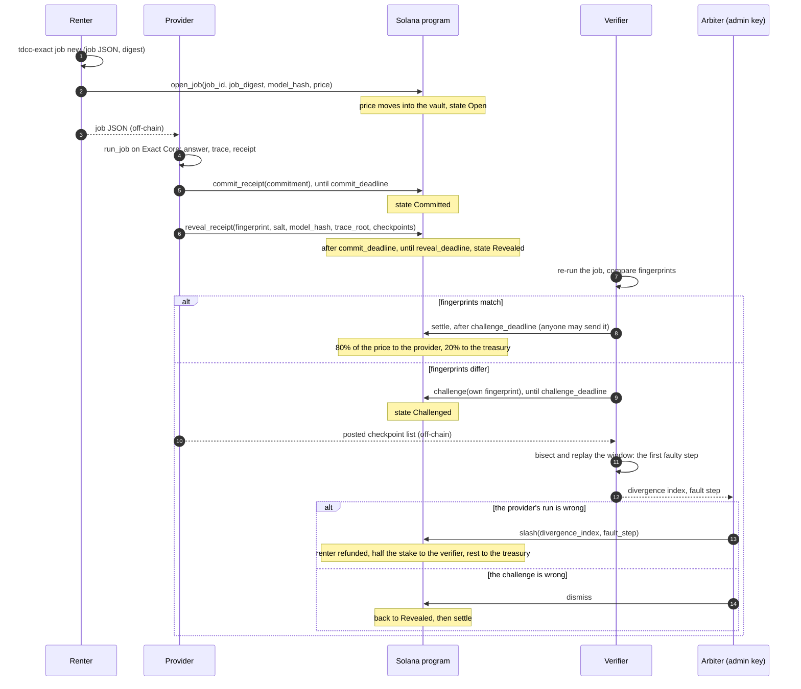
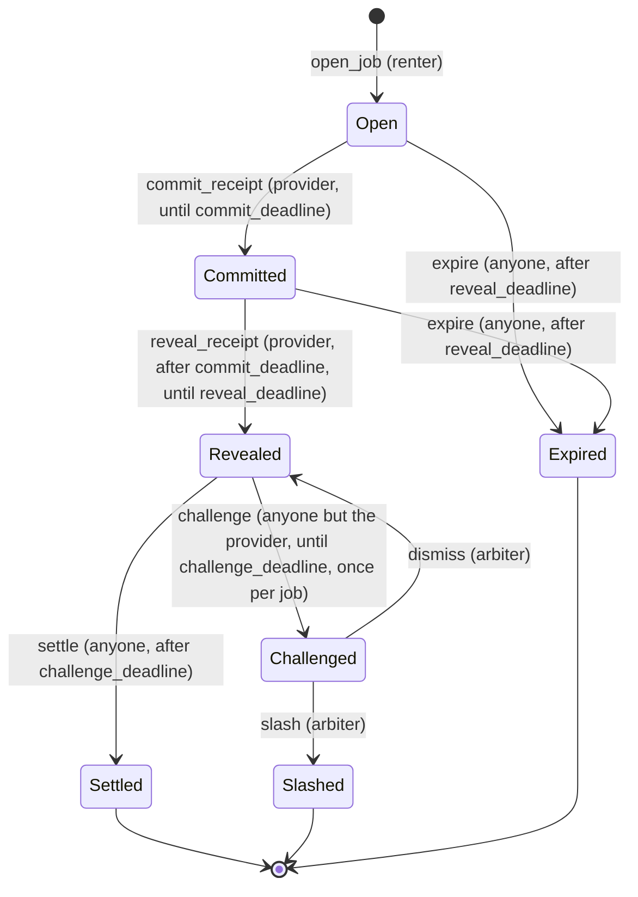

# TDCC Exact: architecture

How the pieces of TDCC Exact fit together: what each one does, how a job moves through them,
what lives on Solana and what stays off it, and where each piece is in the repository.
[exact.md](exact.md) describes the trace log, the receipt and the dispute in detail;
[threat-model.md](threat-model.md) lists what can go wrong; [glossary.md](glossary.md)
defines the terms used here.

## Components

| Component | What it does | Where |
|:--|:--|:--|
| Simulator | The openTPU ISA simulator. The card gives the same bits, so a run on a laptop is a run on the card. The only change for TDCC Exact is an observer hook in `isasim.Machine.run`. | [`opentpu/isasim.py`](../opentpu/isasim.py) |
| Trace log | Folds every stepped instruction, every host write into DRAM and every run start into a SHA-256 chain; takes a checkpoint every 4096 steps and at the end of each device run; the trace root is the Merkle root of the checkpoint leaves. | [`tdcc_exact/trace.py`](../tdcc_exact/trace.py) |
| Backends | `TracedBackend` runs the engine on the simulator with the log on. `CheatingBackend` with `SkipLayer` is the dishonest provider of the demo and the tests. | [`tdcc_exact/backend.py`](../tdcc_exact/backend.py) |
| Oracle jobs and receipts | A job names a model, the prompt's token ids and the Yes and No tokens. `run_job` runs it and builds the receipt: the answer, the model image hash, the logits hash, the trace root and the fingerprint over all of them. | [`tdcc_exact/oracle.py`](../tdcc_exact/oracle.py) |
| Commit-reveal | The commitment a provider posts before its fingerprint is public: `SHA-256(tag || fingerprint || provider key || salt)`. | [`tdcc_exact/commit.py`](../tdcc_exact/commit.py) |
| Model registry | Pins `(model, wformat, cap)` to the DRAM image hash a correct build gives. | [`tdcc_exact/registry.py`](../tdcc_exact/registry.py), [`tdcc_exact/models.json`](../tdcc_exact/models.json) |
| Dispute | Bisects two checkpoint lists to the first checkpoint that differs after one that agrees, then replays that window step by step to name the faulty instruction. Checks a posted list against its trace root first. | [`tdcc_exact/dispute.py`](../tdcc_exact/dispute.py) |
| Settlement | The payout arithmetic: 80/20 of the price on acceptance, 50/50 of the stake on a slash, in basis points, rounded down, remainder to TDCC. | [`tdcc_exact/settle.py`](../tdcc_exact/settle.py), [`tests/data/exact_settle_vectors.json`](../tests/data/exact_settle_vectors.json) |
| Solana program | Anchor program: the market config, the vault, provider stakes, jobs, commit-reveal, challenges, slash, dismiss, settle, expire. | [`programs/tdcc_exact/src/lib.rs`](../programs/tdcc_exact/src/lib.rs) |
| Chain client | `Market`: one transaction per program instruction, account decoding, keypairs outside the repository, Explorer links. | [`tdcc_exact/chain.py`](../tdcc_exact/chain.py) |
| On-chain demo | The five demo steps as transactions on a local validator or devnet. | [`tdcc_exact/chain_demo.py`](../tdcc_exact/chain_demo.py) |
| CLI | `tdcc-exact job new`, `run`, `verify`, `dispute`, `prove`, `demo`, `registry add`. | [`tdcc_exact/cli.py`](../tdcc_exact/cli.py) |

### Planned

These do not exist yet. Today a person runs each step with the CLI, and the demo plays every
role in one process.

| Component | What it will do | Tracked in |
|:--|:--|:--|
| Job store | Holds each job's full description (the job JSON, whose digest is on-chain) and each provider's checkpoint list for the challenge period, under a hash posted with the receipt. | [TODO.md](../TODO.md) item 6 |
| Provider node | Watches the program for `JobOpened` events naming its key, runs the job on the card or the simulator, commits and reveals, keeps the trace, and answers window requests in a dispute. | [TODO.md](../TODO.md) items 6 and 8 |
| Verifier node | Samples revealed receipts, re-runs the jobs, challenges a mismatch, and plays the bisection. | [TODO.md](../TODO.md) items 7 and 8 |

## A job, end to end

The renter, the provider and the verifier each run their part off-chain; every arrow into
the program is one transaction. The arbiter is the market's admin key (see
[On-chain accounts](#on-chain-accounts)).



If the provider never commits, or commits and never reveals, anyone sends `expire` after
`reveal_deadline` and the price goes back to the renter.

The steps the CLI runs for this flow, without the chain, are in the README ("Try the demo");
`tdcc-exact demo --localnet` runs them with the chain.

## On-chain accounts

| Account | Seeds | Holds |
|:--|:--|:--|
| `Config` | `"config", admin` | the admin (the arbiter), the mint, the treasury token account, the vault, `host_bps`, `verifier_bps`, `commit_window`, `challenge_window`, `min_stake`, `unstake_cooldown` (windows in slots) |
| vault | `"vault", config` | one SPL token account for every escrow and every stake of the market; its authority is the config PDA |
| `Provider` | `"provider", config, owner` | the owner, the stake, the number of open jobs, the unlock slot of a pending unstake (0: none) |
| `Job` | `"job", config, renter, job_id` (little-endian u64) | the renter, the provider, the job digest, the expected model hash, the price, the state, the opened slot, the commit, reveal and challenge deadlines, the commitment, the revealed fingerprint and trace root, the checkpoint count, the challenger and its fingerprint |

A market is one `Config`. Its seeds are the admin's key, so anyone can start a market, and a
market's parameters and admin are fixed once it is initialized: the program has no
instruction that changes them. The program id is
`HzpKeqHLg7Mmjh1JmGymef7Z7hf3JXhaagp6UgTSH24A`.

Deadlines are set as the job moves:

- `commit_deadline = opened slot + commit_window` (at `open_job`)
- `reveal_deadline = commit_deadline + commit_window` (at `open_job`; the reveal window reuses
  the commit window's length)
- `challenge_deadline = reveal slot + challenge_window` (at `reveal_receipt`; `dismiss` sets
  it to the current slot)

## The state of a job



| Transition | Who | Money |
|:--|:--|:--|
| `open_job` | the renter; the provider must hold at least `min_stake` and not be leaving; the price must be above 0 | the price moves from the renter into the vault; the provider's open-job count goes up |
| `commit_receipt` | the job's provider | none |
| `reveal_receipt` | the job's provider; the reveal must open the commitment and name the job's model hash | none |
| `challenge` | any key but the provider; a different fingerprint; not after a dismissed challenge | none (no bond yet) |
| `settle` | anyone | `host_bps` of the price to the provider, the rest to the treasury |
| `slash` | the arbiter; the divergence index must be within the posted checkpoint count | the price back to the renter; `verifier_bps` of the provider's whole stake to the challenger, the rest to the treasury; the stake drops to 0 |
| `dismiss` | the arbiter | none; the job can be settled from the next slot |
| `expire` | anyone | the price back to the renter |

`Settled`, `Slashed` and `Expired` are final, and each of them lowers the provider's open-job
count. A provider can `unstake` only with no open jobs and after `unstake_cooldown` slots
from its `request_unstake`; staking again cancels a pending unstake.

Every state change emits an event; [operations.md](operations.md#monitoring) lists them.

## On-chain and off-chain

| On-chain (the program) | Off-chain |
|:--|:--|
| The escrow and the stakes (USDC in the vault) | The job's prompt, its token ids and its parameters (the job JSON) |
| The job digest and the expected model hash | The model weights and the DRAM image they build into |
| The commitment, then the fingerprint, the trace root and the checkpoint count | The run itself, the answer's logits, the checkpoint list, the per-step records of a disputed window |
| The deadlines, enforced by slot | Re-running a job (verifiers), the bisection and the replay |
| Who challenged, with which fingerprint | The arbiter's decision (the program checks only its signature and the index's range) |
| The payouts, computed by `math::accept` and `math::slash` | The same arithmetic in `settle.py`, tested against the same vectors |

The program checks hashes it can recompute (the commitment, through Solana's SHA-256 syscall)
and equalities (the model hash). It does not see the work: a job's correctness is decided off
the chain, by re-running it, and enforced on the chain by the arbiter's `slash`. Replacing
the arbiter by an on-chain bisection game, with `trace.merkle_proof` / `merkle_verify`
showing one checkpoint against the posted trace root per round, is [TODO.md](../TODO.md)
item 6.

## Where things are

```text
programs/tdcc_exact/src/lib.rs   the Solana program (accounts, instructions, events, errors)
tdcc_exact/trace.py              the hash chain, checkpoints, Merkle root and proofs
tdcc_exact/backend.py            the traced simulator backend and the dishonest one
tdcc_exact/oracle.py             jobs, runs, receipts, the fingerprint
tdcc_exact/commit.py             the receipt commitment
tdcc_exact/registry.py           the model registry (models.json)
tdcc_exact/dispute.py            bisection, window replay, the posted-root check
tdcc_exact/settle.py             the payout arithmetic
tdcc_exact/chain.py              the client of the program
tdcc_exact/chain_demo.py         the demo on a local validator or devnet
tdcc_exact/cli.py                the tdcc-exact command
tests/test_exact.py              the verification layer's tests
tests/test_chain.py              the program's tests on solana-test-validator
tests/data/exact_settle_vectors.json   payout cases shared by Python and Rust
Anchor.toml, Cargo.toml          the Anchor workspace
.github/workflows/exact.yml      CI: the tests, the README's commands, the program
```
