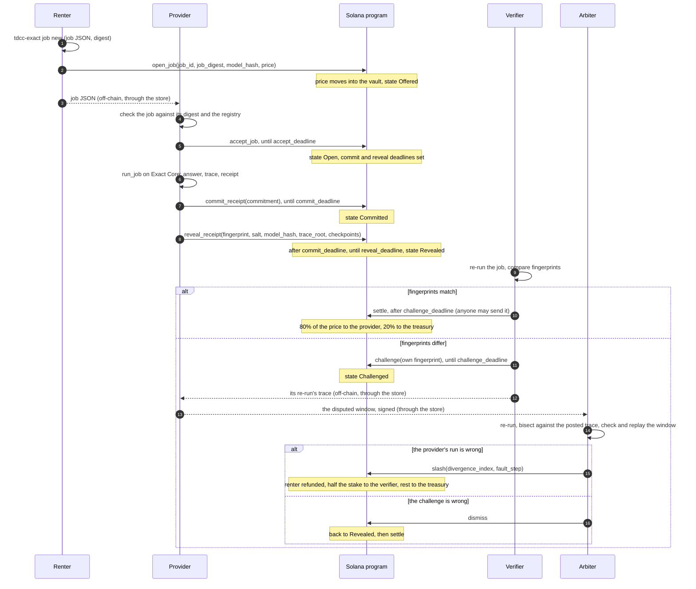

# TDCC Exact: architecture

How the pieces of TDCC Exact fit together: what each one does, how a job moves through them,
what lives on Solana and what stays off it, and where each piece is in the repository.
[exact.md](exact.md) describes the trace log, the receipt and the dispute in detail;
[threat-model.md](threat-model.md) lists what can go wrong; [glossary.md](glossary.md)
defines the terms used here. [exact-rtl.md](exact-rtl.md) describes the trace engine in RTL,
and the proposals not yet built are in [design/](design): the dispute on-chain without the
arbiter ([onchain-dispute.md](design/onchain-dispute.md)) and paying verifiers to verify
([verifier-incentives.md](design/verifier-incentives.md)).

## Components

| Component | What it does | Where |
|:--|:--|:--|
| Simulator | The openTPU ISA simulator. The card gives the same bits, so a run on a laptop is a run on the card. The only change for TDCC Exact is an observer hook in `isasim.Machine.run`. | [`opentpu/isasim.py`](../opentpu/isasim.py) |
| Trace log | Folds every stepped instruction, every host write into DRAM and every run start into a SHA-256 chain; takes a checkpoint every 4096 steps and at the end of each device run; the trace root is the Merkle root of the checkpoint leaves. | [`tdcc_exact/trace.py`](../tdcc_exact/trace.py) |
| Backends | `TracedBackend` runs the engine on the simulator with the log on. `CheatingBackend` with `SkipLayer` is the dishonest provider of the demo and the tests. | [`tdcc_exact/backend.py`](../tdcc_exact/backend.py) |
| Oracle jobs and receipts | A job names a model, the prompt's token ids and the Yes and No tokens (or, for a `generate` job, up to `max_tokens` greedily decoded tokens), and the checkpoint interval. `run_job` runs it and builds the receipt: the answer, the model image hash, the logits hash, the trace root and the fingerprint over all of them. | [`tdcc_exact/oracle.py`](../tdcc_exact/oracle.py) |
| Commit-reveal | The commitment a provider posts before its fingerprint is public: `SHA-256(tag || fingerprint || provider key || salt)`. | [`tdcc_exact/commit.py`](../tdcc_exact/commit.py) |
| Model registry | Pins `(model, wformat, cap)` to the DRAM image hash a correct build gives. | [`tdcc_exact/registry.py`](../tdcc_exact/registry.py), [`tdcc_exact/models.json`](../tdcc_exact/models.json) |
| Dispute | Bisects two checkpoint lists to the first checkpoint that differs after one that agrees, then replays that window step by step to name the faulty instruction. Checks a posted list against its trace root first. | [`tdcc_exact/dispute.py`](../tdcc_exact/dispute.py) |
| Settlement | The payout arithmetic: 80/20 of the price on acceptance, 50/50 of the stake on a slash, in basis points, rounded down, remainder to TDCC. | [`tdcc_exact/settle.py`](../tdcc_exact/settle.py), [`tests/data/exact_settle_vectors.json`](../tests/data/exact_settle_vectors.json) |
| Solana program | Anchor program: the market config, the vault, provider stakes, jobs offered and accepted, commit-reveal, challenges, slash, dismiss, settle, expire, cancel, close. | [`programs/tdcc_exact/src/lib.rs`](../programs/tdcc_exact/src/lib.rs) |
| Chain client | `Market`: one transaction per program instruction, account decoding, keypairs outside the repository, Explorer links. | [`tdcc_exact/chain.py`](../tdcc_exact/chain.py) |
| On-chain demo | The five demo steps as transactions on a local validator or devnet. | [`tdcc_exact/chain_demo.py`](../tdcc_exact/chain_demo.py) |
| CLI | `tdcc-exact job new`, `run`, `verify`, `dispute`, `prove`, `demo`, `registry add`, `market status\|events`, `node`. | [`tdcc_exact/cli.py`](../tdcc_exact/cli.py) |
| Job and trace store | Content-addressed: jobs under their digest, traces under their root, and signed notes (a challenger's pointer to its trace, a provider's revealed window) under a key only their signer can fill. Every read and write is checked against its key. `tdcc-exact node store`. | [`tdcc_exact/node/store.py`](../tdcc_exact/node/store.py) |
| Provider node | Finds the jobs offered to its key, checks each (its digest, the registry's model hash) and accepts only those, runs them, commits and reveals, publishes its trace, and reveals its disputed window when challenged. | [`tdcc_exact/node/provider.py`](../tdcc_exact/node/provider.py) |
| Verifier node | Re-runs a sample of revealed jobs (chosen by a hash of the job and its secret key), challenges a mismatch and publishes its trace. | [`tdcc_exact/node/verifier.py`](../tdcc_exact/node/verifier.py) |
| Arbiter node | Re-runs challenged jobs, bisects against the provider's posted trace, checks its revealed window, and signs `slash` or `dismiss`. | [`tdcc_exact/node/arbiter.py`](../tdcc_exact/node/arbiter.py) |
| Settler node | Settles, expires, cancels the lapsed offers of its own key (a renter's) and closes finished jobs, so no escrow waits on a person. | [`tdcc_exact/node/settler.py`](../tdcc_exact/node/settler.py) |
| Indexer | The program's events and a snapshot of its accounts (`tdcc-exact market status\|events`). | [`tdcc_exact/indexer.py`](../tdcc_exact/indexer.py) |
| Trace engine in RTL | The trace log's hash chain in SystemVerilog, simulated bit for bit against `trace.py`. Standalone: not wired into the sequencer, not run through Vivado, and the checkpoints' state hash comes from the host ([exact-rtl.md](exact-rtl.md)). | [`rtl/exact/`](../rtl/exact) |

The nodes' protocol for a dispute (who publishes what, under which key) is in the docstring of
[`tdcc_exact/node/__init__.py`](../tdcc_exact/node/__init__.py); running them is in
[operations.md](operations.md#running-the-services).

## A job, end to end

The renter, the provider and the verifier each run their part off-chain; every arrow into
the program is one transaction. The arbiter is a key in the market's config, the admin's
unless set (see [On-chain accounts](#on-chain-accounts)).



If the provider does not accept by `accept_deadline`, the renter sends `cancel_job` and the
price goes back to it, with no penalty on anyone. If the provider accepts and never commits,
or commits and never reveals, anyone sends `expire` after `reveal_deadline` and the price goes
back to the renter.

The steps the CLI runs for this flow, without the chain, are in the README ("Try the demo");
`tdcc-exact demo --localnet` runs them with the chain.

## On-chain accounts

| Account | Seeds | Holds |
|:--|:--|:--|
| `Config` | `"config", admin` | the admin, the arbiter, the mint, the treasury token account, the vault, `host_bps`, `verifier_bps`, `commit_window`, `challenge_window`, `min_stake`, `unstake_cooldown` (windows in slots) |
| vault | `"vault", config` | one SPL token account for every escrow and every stake of the market; its authority is the config PDA |
| `Provider` | `"provider", config, owner` | the owner, the stake, the number of open jobs, the unlock slot of a pending unstake (0: none) |
| `Job` | `"job", config, renter, job_id` (little-endian u64) | the renter, the provider, the job digest, the expected model hash, the price, the state, the opened slot, the accept, commit, reveal and challenge deadlines, the commitment, the revealed fingerprint and trace root, the checkpoint count, the challenger and its fingerprint |

A market is one `Config`. Its seeds are the admin's key, so anyone can start a market, and a
market's parameters and admin are fixed once it is initialized; the one thing the admin can
change is the arbiter key (`set_arbiter`). The program id is
`HzpKeqHLg7Mmjh1JmGymef7Z7hf3JXhaagp6UgTSH24A`.

Deadlines are set as the job moves:

- `accept_deadline = opened slot + commit_window` (at `open_job`), or the renter's absolute
  commit deadline when it gives one
- `commit_deadline = acceptance slot + commit_window` (at `accept_job`); it may instead be
  given by the renter at `open_job` (an absolute slot, at most `commit_window` away), so one
  job fanned out to several providers shares it
- `reveal_deadline = commit_deadline + commit_window` (at `accept_job`; the reveal window
  reuses the commit window's length)
- `challenge_deadline = reveal slot + challenge_window` (at `reveal_receipt`; a dismissal does
  not change it, so another verifier may still challenge)
- `ruling_deadline = challenge slot + arbiter_window` (at `challenge`; after it anyone can
  dismiss)

## The state of a job

```mermaid
stateDiagram-v2
    [*] --> Offered: open_job (renter)
    Offered --> Open: accept_job (provider, until accept_deadline)
    Offered --> Expired: cancel_job (renter, after accept_deadline)
    Open --> Committed: commit_receipt (provider, until commit_deadline)
    Open --> Expired: expire (anyone, after reveal_deadline)
    Committed --> Revealed: reveal_receipt (provider, after commit_deadline, until reveal_deadline)
    Committed --> Expired: expire (anyone, after reveal_deadline)
    Revealed --> Challenged: challenge (anyone but the provider and the arbiter, with a bond, until challenge_deadline)
    Revealed --> Settled: settle (anyone, after challenge_deadline)
    Challenged --> Slashed: slash (arbiter, until ruling_deadline)
    Challenged --> Revealed: dismiss (arbiter, or anyone after ruling_deadline)
    Settled --> Closed: close_job (anyone)
    Slashed --> Closed: close_job (anyone)
    Expired --> Closed: close_job (anyone)
    Closed --> [*]
```



| Transition | Who | Money |
|:--|:--|:--|
| `open_job` | the renter; the provider must hold at least `min_stake` and not be leaving; the price must be above 0 | the price moves from the renter into the vault; nothing of the provider's is locked |
| `accept_job` | the job's provider, until `accept_deadline`, holding at least `min_stake` and not leaving | none; the provider's open-job count goes up |
| `cancel_job` | the job's renter, after `accept_deadline` (another key: `NotTheRenter`) | the price back to the renter; no penalty; the job ends `Expired` (event `JobCancelled`) |
| `commit_receipt` | the job's provider | none |
| `reveal_receipt` | the job's provider, holding at least `min_stake`; the reveal must open the commitment, name the job's model hash, and its fingerprint and trace root must be the hashes of their revealed parts (answer, logits hash, tree root, count) | none |
| `challenge` | any key but the provider and the arbiter; a different fingerprint; not the verifier whose challenge was just dismissed | `challenge_bond` from the verifier into the vault |
| `settle` | anyone | `host_bps` of the price to the provider, the rest to the treasury |
| `slash` | the arbiter, before the ruling deadline; the divergence index must be within the posted checkpoint count | the price back to the renter; `verifier_bps` of the provider's whole stake and the bond to the challenger, the rest to the treasury; the stake drops to 0 |
| `dismiss` | the arbiter, or anyone after the ruling deadline | the bond to the provider; the job is Revealed again until its original challenge deadline |
| `expire` | anyone | the price back to the renter, plus `non_reveal_penalty` from the stake when the provider committed and did not reveal |
| `close_job` | anyone, on a final job | the job account's rent back to the renter |

`Settled`, `Slashed` and `Expired` are final, and each of them reached from an accepted job
lowers the provider's open-job count (a cancelled offer never raised it); `close_job` then
removes the account. A provider can `unstake` only with no open jobs and after `unstake_cooldown` slots
from its `request_unstake`; staking again cancels a pending unstake.

Every state change emits an event; [operations.md](operations.md#monitoring) lists them.

## On-chain and off-chain

| On-chain (the program) | Off-chain |
|:--|:--|
| The escrow and the stakes (USDC in the vault) | The job's prompt, its token ids and its parameters (the job JSON) |
| The job digest and the expected model hash | The model weights and the DRAM image they build into |
| The commitment, then the fingerprint, the trace root and the checkpoint count | The run itself, the answer's logits, the checkpoint list, the per-step records of a disputed window |
| The deadlines, enforced by slot | Re-running a job (verifiers), the bisection and the replay |
| Who challenged, with which fingerprint | The arbiter's decision (the program checks only its signature and the index's range) |
| The payouts, computed by `math::accept` and `math::slash` | The same arithmetic in `settle.py`, tested against the same vectors |

The program checks hashes it can recompute (the commitment, through Solana's SHA-256 syscall)
and equalities (the model hash). It does not see the work: a job's correctness is decided off
the chain, by re-running it, and enforced on the chain by the arbiter's `slash`. Replacing
the arbiter by an on-chain bisection game, with `trace.merkle_proof` / `merkle_verify`
showing one checkpoint against the posted trace root per round, is [TODO.md](../TODO.md)
item 6.

## Where things are

```text
programs/tdcc_exact/src/lib.rs   the Solana program (accounts, instructions, events, errors)
tdcc_exact/trace.py              the hash chain, checkpoints, Merkle root and proofs
tdcc_exact/backend.py            the traced simulator backend and the dishonest one
tdcc_exact/oracle.py             jobs, runs, receipts, the fingerprint
tdcc_exact/commit.py             the receipt commitment
tdcc_exact/registry.py           the model registry (models.json)
tdcc_exact/dispute.py            bisection, window replay, the posted-root check
tdcc_exact/settle.py             the payout arithmetic
tdcc_exact/chain.py              the client of the program
tdcc_exact/chain_demo.py         the demo on a local validator or devnet
tdcc_exact/cli.py                the tdcc-exact command
tdcc_exact/indexer.py            market status and events
tdcc_exact/node/                 the store, provider, verifier, arbiter and settler nodes
rtl/exact/                       the trace engine in RTL (docs/exact-rtl.md), not yet in the core
tests/test_exact.py              the verification layer's tests
tests/test_chain.py              the program's tests on solana-test-validator
tests/test_node.py               the nodes' tests
tests/test_exact_rtl.py          the RTL engine against trace.py (needs Verilator or Icarus)
tests/data/exact_settle_vectors.json   payout cases shared by Python and Rust
Anchor.toml, Cargo.toml          the Anchor workspace
.github/workflows/exact.yml      CI: the tests, the README's commands, the program
```
